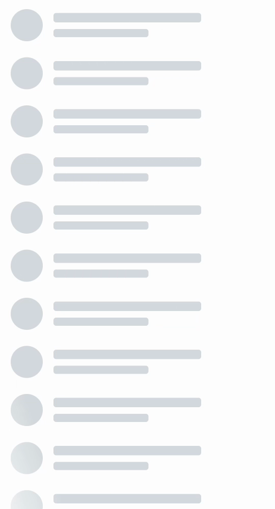
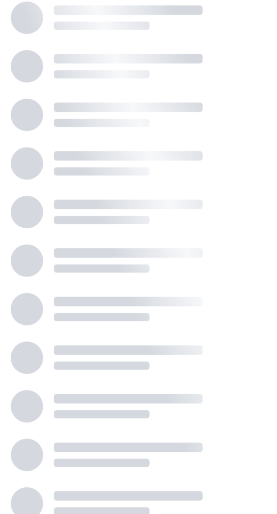

# react-native-skeleton-native

Skeleton and shimmer placeholders for React Native whose animation is drawn by the platform compositor (Core Animation on iOS, RenderThread on Android). The highlight keeps moving while the JavaScript thread and the UI thread are busy, because React never updates it.

<p>
  
  
</p>

- **Native animation.** One sweep per group, started and driven natively. No `Animated` loop, no re-render per frame.
- **One highlight across many blocks.** `SkeletonGroup` shares one animation clock and one coordinate space, so a single band sweeps across every block inside it.
- **Follows the system.** Default colours switch with light and dark mode without a React re-render. The sweep direction follows RTL. Reduce Motion (iOS) and "Remove animations" (Android) are respected.
- **Accessible.** A group is one accessibility element with a label (`"Loading"` by default); the blocks inside are hidden from screen readers.
- **Typed, small API.** `Skeleton`, `Skeleton.Circle`, `Skeleton.Text`, `SkeletonGroup` and `Shimmer`.

## Install

```sh
npm install react-native-skeleton-native
cd ios && pod install
```

Requires React 18.2 or later and React Native 0.71 or later. It has native code, so you need a development build or a bare app; Expo Go cannot load it.

## Usage

```tsx
import { Skeleton, SkeletonGroup } from 'react-native-skeleton-native';

function FeedPlaceholder() {
  return (
    <SkeletonGroup>
      <View style={{ flexDirection: 'row', gap: 12 }}>
        <Skeleton.Circle size={48} />
        <View style={{ flex: 1 }}>
          <Skeleton height={14} width="70%" />
          <Skeleton.Text lines={2} />
        </View>
      </View>
    </SkeletonGroup>
  );
}
```

Wrap the blocks that should share one sweep in a `SkeletonGroup`. Animation props set on the group are inherited by everything inside, and any block can override them.

### Shimmer over your own content

`Shimmer` draws the moving highlight over arbitrary children, limited to the pixels they cover.

```tsx
import { Shimmer } from 'react-native-skeleton-native';

<Shimmer duration={1800}>
  <Image source={placeholder} style={{ width: 120, height: 120 }} />
</Shimmer>
```

## Components

| Component | What it draws |
| --- | --- |
| `Skeleton` | One block. `width` (number or percentage, default `'100%'`), `height` (default 16), `radius` (default 4). |
| `Skeleton.Circle` | A circle. `size` (default 40). |
| `Skeleton.Text` | Lines of text. `lines` (default 3), `lastLineWidth` (default `'60%'`), `lineHeight` (default 12), `gap` (default 8), `radius` (default 4). |
| `SkeletonGroup` | Shares one animation clock and coordinate space between its children, and is one accessibility element. |
| `Shimmer` | The moving highlight over your own children. Takes the animation props except `baseColor`. |

All of them also accept `style` and `testID`. `Skeleton`, `Skeleton.Circle`, `Skeleton.Text` and `SkeletonGroup` accept `accessibilityLabel`.

## Animation props

Shared by every component, and inheritable from a `SkeletonGroup`.

| Prop | Default | Notes |
| --- | --- | --- |
| `variant` | `'shimmer'` | `'shimmer'`, `'pulse'` or `'none'`. |
| `duration` | `1400` | Milliseconds for one sweep or pulse. Clamped to 100 to 60000. |
| `direction` | `'auto'` | `'ltr'`, `'rtl'` or `'auto'` (follows `I18nManager.isRTL`). |
| `angle` | `20` | Lean of the highlight band in degrees, clamped to -45..45. |
| `baseColor` | theme grey | Block colour. |
| `highlightColor` | theme grey | Colour at the centre of the highlight. |
| `animated` | `true` | `false` pauses the animation and shows the static block. |
| `reduceMotion` | `'system'` | `'system'` follows the OS setting, `'always'` behaves as if it were on, `'never'` ignores it. |

Default colours: light `#E1E4E8` base and `#F5F7F9` highlight, dark `#2B2E33` base and `#3D4148` highlight. They are exported as `DEFAULT_COLORS`, with `DEFAULT_DURATION_MS`, `DEFAULT_ANGLE` and `DEFAULT_LABEL`.

Invalid values (a negative duration, an unknown variant) fall back to the default and log a warning in development builds.

## Status of version 0.1.0

The JavaScript has unit tests. The example app has been run on an Android emulator and an iOS simulator, which is where the screenshots above come from. Nothing has been run on a physical device yet, and I have not published measurements, so treat the "keeps moving while busy" behaviour as the design goal until you have checked it in your own app.

## Contributing

```sh
npm install
npm run check   # typecheck, tests, build
```

The `example/` folder is a React Native app that uses the packed library (`npm run example:install`).

## License

MIT
